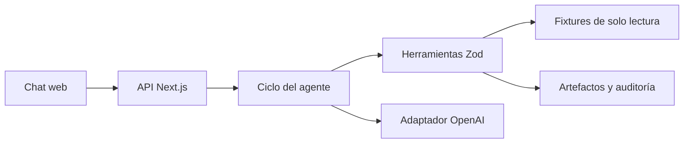

# Solución técnica — Registro de proveedores

## 1. Problema en una frase

Una analista administrativa necesita completar solicitudes repetitivas de registro de proveedores sin transcribir datos a mano ni perder trazabilidad, manteniendo la firma y cualquier envío bajo decisión humana.

## 2. Arquitectura

La solución es un monolito modular Next.js + TypeScript. La interfaz llama a la API; la capa de aplicación mantiene sesiones y controla el ciclo; las herramientas son la única vía de acceso a fixtures y salidas.

El módulo reusable vive en `modulo/`: `agent.md` aporta el prompt con los metadatos de la plataforma, `skill/registro-proveedor/SKILL.md` contiene el conocimiento y `tools/proveedor.ts` expone las herramientas que usa la aplicación. El ciclo carga el cuerpo Markdown sin frontmatter. La lógica determinista se implementa en `src/tools/proveedor.ts` y `src/infrastructure/filesystem/`, sin depender del servidor Next.js.

## 3. Ciclo del agente y aprobación

`POST /api/chat` valida el texto y crea o recupera una sesión en memoria. El ciclo construye el prompt, solicita una respuesta al adaptador, valida cada llamada con el esquema Zod registrado, ejecuta la herramienta, agrega el resultado estructurado a la conversación y vuelve al modelo. El ciclo termina con una respuesta o al alcanzar 12 iteraciones por defecto, con máximo configurable de 25. Hay límite aproximado de tokens por sesión, máximo de salida por solicitud y timeout del proveedor.

Al preparar un paquete, el servidor asocia una aprobación pendiente con la acción y el `casoId`, pregunta de forma explícita y espera el turno siguiente. Solo un “sí” inequívoco en ese turno ejecuta `proveedor_simular_envio`; la aplicación no acepta un booleano de aprobación enviado por el modelo. La aprobación se consume en el intento. El resultado es únicamente `out/<caso>/ENVIO-SIMULADO.md`; no hay integración externa.

## 4. Modelo y costo estimado

El adaptador usa la API de Chat Completions de OpenAI y deja el modelo configurable en `OPENAI_MODEL`. El valor inicial es `gpt-6-luna`, un modelo de menor costo adecuado para tareas enfocadas y llamadas a herramientas; se puede sustituir sin tocar el ciclo. Referencias: [ficha del modelo](https://developers.openai.com/api/docs/models/gpt-6-luna) y [precios de API](https://developers.openai.com/api/docs/pricing).

Estimación de planeación por caso: 8.000 tokens de entrada y 2.000 de salida (incluye las rondas del agente) equivalen aproximadamente a **US$0,0018** con las tarifas estándar publicadas de US$0,10 y US$0,50 por millón de tokens, respectivamente. Es un supuesto, no una medición; el costo real depende del historial, las herramientas y el precio vigente. El límite de tokens reduce el uso, pero debe contrastarse con el consumo reportado en la cuenta del proveedor.

## 5. Diseño futuro para portales web

Esta versión no automatiza portales. Una fase posterior podría usar un navegador controlado o una extensión con acciones limitadas a campos previamente revisados. CAPTCHA, MFA, cambios de interfaz y errores de sesión requieren intervención humana. El humano introduce credenciales, verifica la página y hace clic en “Enviar”; el agente puede preparar valores copiables, señalar campos pendientes y guardar evidencia de la revisión, sin recibir contraseñas ni tokens de sesión.

Las credenciales deberían provenir de un gestor de secretos con acceso de mínimo privilegio y rotación. Nunca vivirían en Git, el prompt, los logs ni los resultados de herramientas. No se debe habilitar esta automatización hasta definir controles de autorización, auditoría y manejo de errores por portal.

## 6. Decisiones y trade-offs

1. **Filesystem en vez de base de datos:** hace el ejercicio reproducible y simple de ejecutar; una base de datos sería necesaria para concurrencia, retención y recuperación de sesiones en producción.
2. **Mapeo determinista antes que inferencia libre:** reduce errores y mantiene evidencia del origen; etiquetas nuevas quedan pendientes y exigen ampliar el glosario o revisión humana.
3. **Archivos Excel/PDF generados desde sus contratos JSON:** los fixtures del reto describen ubicaciones y campos, pero no garantizan un binario de plantilla. Si se entrega `plantilla.xlsx`, se preserva y se escriben únicamente las celdas de valor; sin ese binario se crea una hoja con las ubicaciones descritas. El PDF se genera desde cero, como permite el reto.
4. **Confirmación guardada en el servidor:** el modelo no puede autorizarse a sí mismo. Se restringe a una acción y un caso, y vence al llegar otro turno.
5. **Demo con copia temporal:** permite probar las mismas herramientas sin modelo y evita borrar salidas de una persona o tocar fixtures originales.

## 7. Supuestos

- Los JSON de entrada siguen la estructura del PRD y los campos usan etiquetas o sinónimos documentados en el glosario.
- La fecha de vigencia es una fecha calendario ISO; se compara en `America/Bogota`.
- Los soportes son archivos locales incluidos en el índice. Si faltan, el paquete se bloquea para firma.
- Los datos del maestro y los casos reales no deben publicarse. El repositorio incluye solamente un caso de demostración sintético.
- Las sesiones en memoria se pierden al reiniciar el servidor y esta versión no es multiusuario.

## 8. Cobertura

| Historia | Estado | Evidencia / pendiente |
|---|---|---|
| HU-1 Leer solicitud | Hecho para contratos disponibles | Zod valida solicitud/plantilla; error controlado en fixtures inválidas. Falta ejecutar con fixtures originales. |
| HU-2 Mapear campos | Hecho para glosario y maestro | Conserva fuente, faltantes y nota tributaria extranjera; requiere confirmar reglas adicionales de los casos reales. |
| HU-3 Generar formulario | Hecho en demo sintética | Excel P0, PDF P1 y Markdown portal P2; verificar las celdas y campos de los originales. |
| HU-4 Paquete | Hecho para el contrato de soportes | Incluye formulario, soportes presentes, checklist y borrador; validar con el índice real. |
| HU-5 Errores | Hecho a nivel de herramienta/API | Errores normalizados y pruebas de rutas y confirmación; faltan pruebas con cada fixture real. |
| API y chat | Parcial | API, interfaz y sesiones funcionan localmente; requiere clave del modelo para conversación real y despliegue público pendiente. |
| Bonus módulo reusable | Hecho | Prompt, skill y entrada de herramientas en `modulo/`; la aplicación carga e importa esas mismas piezas. |

## 9. Uso de IA

Se usó ChatGPT/Codex para analizar el PRD y los specs, proponer la estructura, implementar código, generar pruebas y redactar esta documentación. El usuario debe revisar y comprender el código antes de la defensa, en especial mapeo, validación de rutas, manejo de datos bancarios, presupuesto del modelo y confirmación humana. No se usaron documentos reales ni secretos para generar el caso de demostración.

## 10. Riesgos y mitigaciones de producción

- **Dato incorrecto o plantilla ambigua:** mantener procedencia, umbral de revisión, validación determinista y aprobación de analista.
- **Prompt injection en un correo o soporte:** tratar documentos como datos; herramientas con operaciones limitadas, esquemas estrictos y ninguna ejecución de comandos.
- **Exposición de datos personales o bancarios:** minimización en resultados, correo y logs; controles de acceso, cifrado, retención y pruebas de privacidad antes de producción.
- **Credenciales/API y gasto:** secreto administrado fuera del repositorio, límites de tokens/iteraciones, cuotas, rate limiting y métricas de uso por sesión.
- **Archivos maliciosos o rutas manipuladas:** validar IDs y rutas, resolver enlaces simbólicos, usar límites de tamaño y análisis antivirus en un entorno aislado.
- **Sesiones en memoria:** no sirven para múltiples instancias ni recuperación. Producción requiere persistencia cifrada, expiración y control de acceso.
- **Dependencia de un proveedor y precio variable:** adaptador desacoplado, modelo configurable, pruebas contractuales y revisión de tarifas antes de cada despliegue.
- **Firma/envío accidental:** la aplicación no implementa esas integraciones; una fase futura debe mantener aprobación humana separada, auditada y por caso.
